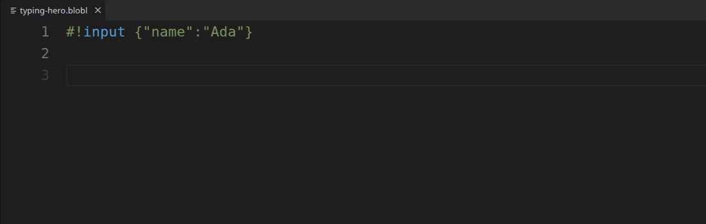
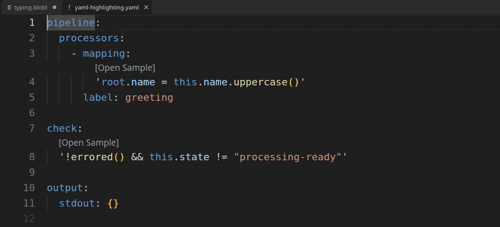
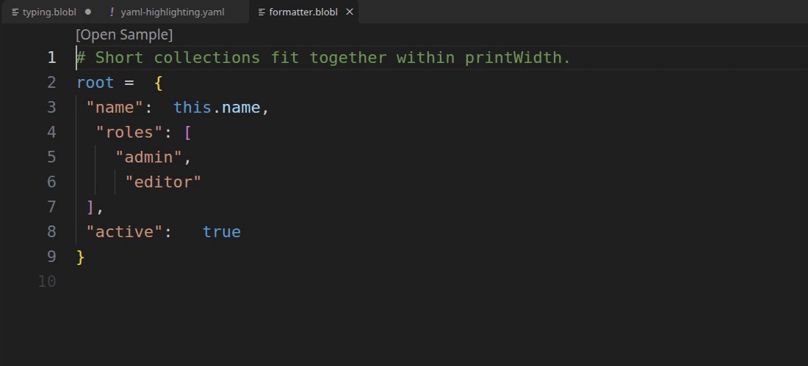
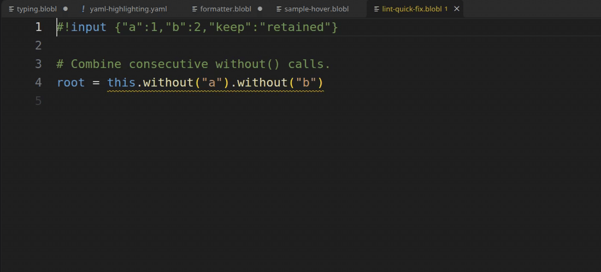
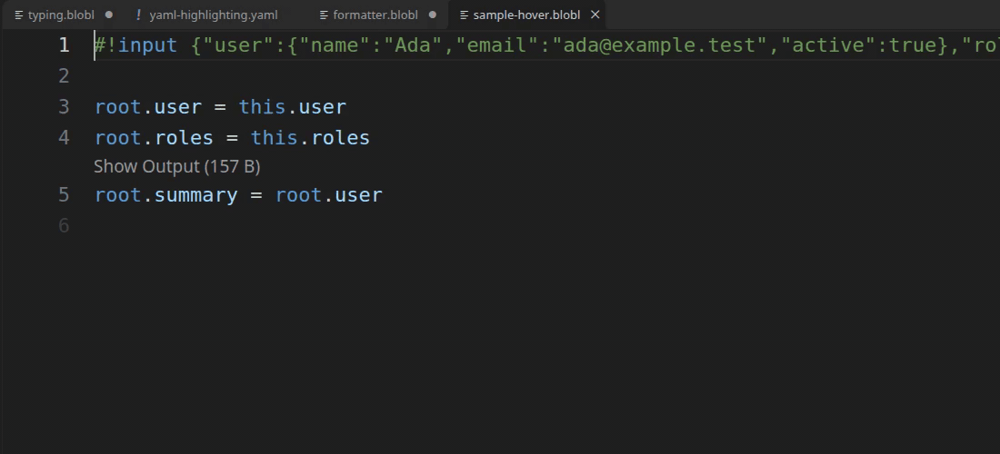

# Bloblang for VS Code

Bloblang highlighting, diagnostics, formatting, completion, hover, definitions,
and references, powered by [bloblang-lsp](https://github.com/teyfix/bloblang-lsp).
The extension manages the `blobl` tool for editor features and terminal linting
and formatting. An installed tool starts without waiting for the network and
works offline; stable releases are checked in the background.
If another extension also provides Bloblang, disable one provider to avoid duplicate
language servers. This extension includes its own grammars and needs no Benthos
extension.



Open a `.blobl` or `.bloblang` file. Bloblang is also highlighted inside YAML
`mapping`, `request_map`, `result_map`, `args_mapping`, `fields_mapping`, `check`,
and test `bloblang` values, including literal/folded blocks and quoted/plain
scalars. The test `bloblang` key is a legacy alias for `mapping`; prefer `mapping`
in new files. Values can start on the line after the key and span multiple lines,
including nested `output_batches` expressions. `${! ... }` interpolation is
highlighted in YAML strings.
In valid YAML documents, embedded Bloblang receives server diagnostics, hover,
completion and navigation with positions mapped to the original document. Mapping
values also receive formatting; interpolation expressions are not formatted.
External `mapping: from "mapping.blobl"` values support file navigation and missing
file diagnostics.



With a CUE extension providing the host grammar, CUE mapping strings (ordinary,
raw and multiline) and interpolation receive highlighting. CUE language server
features continue to belong to the CUE extension.

## Managed tool and terminal CLI

With the default settings, activation prepares `blobl` and makes it available in
new VS Code integrated terminals. The language server starts when you open a
Bloblang document or a YAML document with `bloblang.yaml.enabled` enabled.
Set `bloblang.cli.enabled` to `false` to disable the integrated terminal PATH
contribution. Existing terminals may need to be relaunched after installation or
an update.

```sh
blobl --version
blobl lint mappings/
blobl lint --fix mappings/
blobl lint --format json config.yaml
blobl fmt --write mappings/
blobl fmt --check '**/*.blobl'
```

Quote glob patterns so `blobl` expands them; `**` matches recursively. Linting is
static and does not execute mappings or load sample files. `--fix` applies only
available safe fixes. `fmt --check` returns `1` for formatting changes; lint
returns `1` for warnings or errors, and usage/configuration failures return `2`.
See the [CLI reference](https://github.com/teyfix/bloblang-lsp/blob/main/docs/cli.md)
for stdin, YAML handling and all options.

The tool runs on the **VS Code extension host**. In Remote SSH, WSL or a dev
container, that is the remote machine, WSL distribution or container. Downloads
match that host's OS and CPU: Linux, macOS and Windows, each with amd64 (x64) and
arm64 builds. Remote installation and terminal PATH changes apply to that host.

On first installation, the extension reads the public `blobl-release.json`
manifest from GitHub Releases, downloads the raw binary from its version-tagged
release, and checks that `blobl --version` matches the manifest before using it.
No GitHub token is needed. Later activations reuse the verified cached tool and
check for stable updates in the background at most about once a day. A failed
download or version check keeps the installed tool usable. Background installs
take effect on the next server start; **Bloblang: Check for Tool Updates** checks
immediately and restarts an active managed language server after an update.
Use `blobl --version` in a new integrated terminal to check the selected CLI.

A cached legacy `language-server` from an earlier extension can still provide
editor features offline, but it does not provide the `blobl` terminal commands.

For shells outside VS Code, run **Bloblang: Install CLI for External Terminals**.
Choose an absolute folder on the extension host; the defaults are `~/.local/bin`
on Linux/macOS and `%LOCALAPPDATA%\Bloblang\bin` on Windows. The command copies
the managed binary and asks before replacing a different existing file. Add that
folder to your shell's PATH if needed, then open a new terminal and run
`blobl --version`. The command reports the installed path and PATH instructions;
it does not edit shell profiles or the Windows registry. This copy remains after
extension removal and is updated only when you run the install command again.

## Commands and settings

- **Bloblang: Restart Language Server** restarts using the current settings.
- **Bloblang: Show Language Server Logs** opens server output.
- **Bloblang: Check for Tool Updates** installs the latest stable managed tool.
- **Bloblang: Install CLI for External Terminals** copies the managed CLI to a
  folder you choose.
- **Bloblang: Format Embedded Mappings** formats Bloblang in the active YAML file
  while preserving the surrounding YAML. Short scalar values keep their quoting
  style; mappings that wrap onto multiple lines use literal blocks. Changed folded
  blocks are rewritten as literal blocks. Your default YAML formatter stays usable.
- Use **Format Document** in Bloblang files.
- With bloblang-lsp **v0.2.2+**, use **F2** (Rename Symbol) on `let` variables,
  lambda parameters or named maps. Rename respects scope, follows literal
  `.apply("name")` references through imports, and works in embedded YAML.
  Field paths and computed map names are not renamed. See the server's
  [rename guide](https://github.com/teyfix/bloblang-lsp/blob/main/docs/features/rename.md).

`bloblang.server.path` overrides the managed server with a path or PATH command.
It supports `${workspaceFolder}` and `${userHome}`; relative paths are resolved
from the first workspace folder. `bloblang.server.args` supplies arguments exactly
as configured for a custom server. For a custom `blobl`, set the arguments to
`["lsp"]`; the managed tool selects `lsp` automatically. A custom server path
disables automatic managed tool preparation and integrated terminal CLI exposure.
`bloblang.yaml.enabled` controls YAML server features (highlighting is always
available). `bloblang.trace.server` enables protocol logging. Lifecycle messages
stay in the output channels. A quiet status bar indicator shows starting, ready,
or failed; click it to open server logs. Initialization shows no notification.
Startup failures offer logs and settings.

## Workspace configuration and linting

Create `.bloblangrc.json` in your project. VS Code automatically provides
configuration completion and validation through the bundled schema. Each document
uses the nearest configuration from its directory up to the deepest containing
workspace root, inclusive. Embedded mappings use the YAML file's location.
A nested configuration replaces ancestor settings; configurations are not merged.
Loose documents and CLI inputs use the nearest Git project boundary, or search
up to the filesystem root outside Git. Configuration edits, creation and deletion
apply without restarting the server. Defaults are 80 columns and YAML previews.
All lint rules are enabled:
`prefer-with` and `prefer-any` start as hints; the others start as warnings:

```json
{
  "formatter": { "printWidth": 80 },
  "preview": { "format": "yaml" },
  "lint": {
    "enabled": true,
    "rules": {
      "correctness/environment/require-fallback": "warn",
      "correctness/variables/no-unused-let": "warn",
      "style/assignments/prefer-grouped": {
        "severity": "warn",
        "minAssignments": 3
      },
      "style/objects/prefer-with": "hint",
      "style/objects/prefer-without": "warn",
      "style/objects/combine-without": "warn",
      "style/arrays/prefer-any": "hint"
    }
  }
}
```

CLI directory and glob scans honor `.gitignore` and `.bloblangignore`, including
nested ignore files. Add Gitignore-style patterns in `files.exclude`, relative to
the configuration file's directory:

```json
{
  "files": {
    "exclude": ["generated/**"],
    "respectGitignore": true
  }
}
```

Set `files.respectGitignore` to `false` to skip `.gitignore` while retaining the
other exclusions. `--no-ignore` bypasses ignore rules for a CLI run; explicitly
named files also bypass them. These settings control CLI file selection and do
not suppress diagnostics in open editor documents.

`printWidth` accepts integers from 20 to 1000. Set `preview.format` to `json`
for JSON previews. Hovers, inlay tooltips, and output previews use the same format
and width; short collections stay together when they fit. The formatter preserves
comments and string contents, collapses short expressions, wraps longer ones,
and keeps unary operators adjacent to their operands, such as `index(-1)`. Width
guides expression layout; preserved strings and comments can exceed it.
Long method chains break after dots. Lambda bodies wrap independently, keeping
short calls such as `.join("; ")` together (bloblang-lsp v0.2.2+).



Rule keys remain flat for autocomplete; their slash-separated IDs group related
rules. Each accepts `off`, `hint`, `info`, `warn`, or `error`, or an object with
`severity` and its documented options. Only `style/assignments/prefer-grouped`
accepts `minAssignments` (at least 3). VS Code reports invalid configuration through
the schema; the server falls back to defaults without stopping other language
features.

| Rule | Suggestion |
| --- | --- |
| `correctness/environment/require-fallback` | Handle an unset `env()` with a default or explicit failure. |
| `correctness/variables/no-unused-let` | Report a binding that is never referenced in its scope. |
| `style/assignments/prefer-grouped` | Group consecutive field assignments when output state allows it. |
| `style/objects/prefer-with` | Use `.with(...)` for a projection of the receiver's same-named fields. |
| `style/objects/prefer-without` | Use `.without(...)` when copying an object then deleting fields. |
| `style/objects/combine-without` | Combine consecutive `.without(...)` calls. |
| `style/arrays/prefer-any` | Use `.any(...)` for a filtered array existence check. |

For example, `env("ARTIFACT_DIR").or("./artifacts")` supplies a default, and
`env("ARTIFACT_DIR").or(throw("ARTIFACT_DIR is required"))` explicitly fails.
An unset environment variable returns `null`, so `.catch(...)` by itself does not
handle it; `.not_null().catch(...)` does.

Suppress a rule for the next source line with its full ID:

```bloblang
# bloblang-lint-disable-next-line correctness/environment/require-fallback -- guaranteed by the launcher
root.artifact_dir = env("ARTIFACT_DIR")
```

Lint diagnostics use these IDs in standalone and embedded YAML mappings. Only
`style/objects/combine-without` offers a Quick Fix, when both calls have literal
string arguments and the expression contains no comments. For YAML, that fix is
available in plain scalars and literal blocks; quoted and folded scalars receive
diagnostics without edits. The server does not provide a Fix All action.

The other rules provide suggestions to review. `.with()` omits missing fields,
where object construction retains `null`; `.assign()` merges nested objects,
where direct field assignments replace them; `.any()` short-circuits, which can
change predicate errors or side effects. Formatting does not apply lint refactors.
See the server's [lint guide](https://github.com/teyfix/bloblang-lsp/blob/main/docs/features/lint.md)
for the rule conditions and examples.



## Sample input and metadata

For `mapping.blobl`, create the sibling `mapping.sample.json`,
`mapping.sample.yaml`, or `mapping.sample.yml` to get runtime previews and type
guidance:

```json
{"$bloblang":{"input":{"name":"Ada"},"meta":{"topic":"people"}}}
```

```yaml
$bloblang:
  input:
    name: Ada
  meta:
    topic: people
```

Metadata is optional. The file envelope is required. Supply an optional `root`
inside `$bloblang` to preview mappings that update an existing output (for example,
a `result_map`), while `input` stays the separate value read through `this`.
`#!root` and `#!root_from` can override that initial output. Missing automatic samples
produce an informational suggestion to add a sample; static language features
still work. Multiple matching sibling sample files produce a diagnostic so sample
selection is unambiguous. Invalid sample files or directives disable preview,
while static diagnostics, documentation and navigation remain available. Changes,
creation and deletion of sample files refresh previews.

YAML inline mappings are numbered in document order from `001`. For
`pipeline.yaml`, selection checks an explicit adjacent comment first, then
`pipeline.sample-001.json` for the first mapping, then the shared
`pipeline.sample.json`. JSON, YAML, and YML are supported at each level. External
`from` mappings and `${! ... }` interpolations do not consume a number.
Interpolations use the shared sibling sample. Selected files use the `$bloblang`
envelope above.

```yaml
# bloblang-sample: pipeline.sample-001.json
check: |
  !errored() && this.state != "processing-ready"
```

Place the comment immediately before the mapping key, at the same indentation.
Explicit sample paths resolve relative to the YAML file. A missing explicit file
produces an error for that mapping; missing automatic samples remain informational.
File creation, updates, and deletion refresh previews.

Leading directives override fields from the selected sample. `#!sample` and
`#!sample_from` supply the entire sample and resolve automatic sibling ambiguity:

```bloblang
#!input {"name":"Ada"}
#!meta {"topic":"people"}
root.name = this.name.uppercase()
root.topic = meta("topic")
```

Use `#!sample {"input":{"name":"Ada"},"meta":{"topic":"people"}}` to provide
the entire sample inline. `#!input_from`, `#!meta_from`, `#!root_from`, and
`#!sample_from` load JSON/YAML files relative to the mapping file; these files require the
`$bloblang` envelope. A missing explicitly referenced file is an error at the
directive. Multiline arguments use comment continuation lines:

```bloblang
#!sample |
#| input:
#|   name: Ada
#| meta:
#|   topic: people
root = this
```

Sample hover shows the original input `this` and selected expression values.
Hovering a variable name in `let name = expression` shows its assigned value when
a valid sample is available, and later `$name` references use their current scope.
Hovering the assignment target `root` shows the input at the first assignment,
then the prior output before later assignments. Reading `root` on the right hand
side evaluates the actual output state, which may be unavailable before its first
assignment. Assignment end hints show the resulting output.
Evaluation uses complete preceding statements, preserving named maps, imports,
variables, and message metadata. Completion can use a known sample value's type;
without a sample, ordinary documentation and completion remain available.

For large values, **Show Input** and **Show Output** lenses open the full formatted
preview in a temporary YAML or JSON file using the originating document's settings.
With bloblang-lsp v0.2.3+, hover and inlay tooltip bodies are capped at 4 KiB / 60
lines. Large values show a **Preview truncated** notice at the top and point to
these lenses. Collections, nesting and long strings are limited before formatting;
mapping evaluation and the full preview still use the complete sample.
**Open Sample** lenses open the selected sample files.



## Build and package

Install [Bun](https://bun.sh), Go matching the sibling server's `go.mod`, and a C
compiler for schema generation. Keep `bloblang-lsp` beside this repo while
building the extension:

```sh
bun install --frozen-lockfile
bun run check
bun run package
code --install-extension vscode-bloblang-0.3.0.vsix
```

The universal package contains `dist/extension.js`, language grammars/configuration,
and `schemas/bloblangrc.schema.json`; it contains no server binary. JavaScript
dependencies are bundled. The extension downloads a matching raw `blobl` binary
into VS Code global storage on the extension host and reuses it on later starts.
Set `BLOBLANG_LSP_REPO` to use another checkout for schema generation.

Development can use `bloblang.server.path` pointing to a sibling server binary.
For `blobl`, also set `bloblang.server.args` to `["lsp"]`.
The configuration schema is generated from the server rule registry; run
`bun run schema` after changing rules or options. Packaging regenerates it before
building. Run `bun run build:watch`, then launch an Extension Development Host.
Grammar tests use checked-in host grammar fixtures and run without other projects or editor
extensions. `bun run build:smoke` builds `dist/smoke.cjs`, an extension host test
module; run it with an isolated VS Code profile and extensions directory to check
activation, sampled hover, completion, formatting, YAML mapping, diagnostics, and
restart without interference from other Bloblang extensions.

## License

[MIT](LICENSE)
